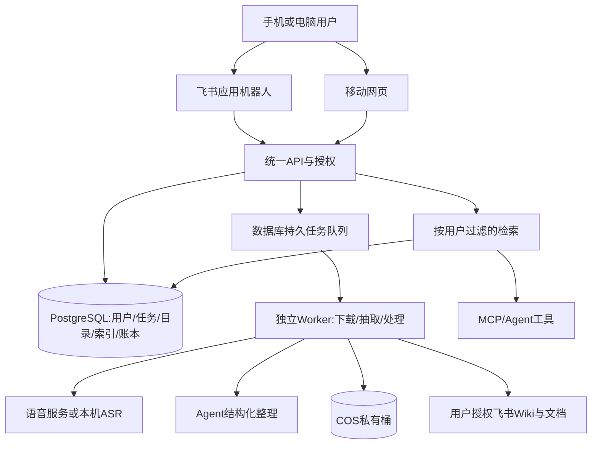

# 飞书个人知识助手：架构与成本设计

版本：2026-10-13；状态：实施基线提案。用户已确认飞书为收集、沉淀和交付体系；本文件是设计，不代表下述新功能已经上线。现有程序仍是本机单用户版本。

## 1. 产品与交付

面向个人学习与知识积累。用户向应用机器人发视频、文章或RSS链接及收藏理由，选择知识库目标节点，收集后返回任务卡片及飞书知识页面。移动网页用于授权、设置、订阅、任务和检索。Agent通过授权工具检索知识；公众号写稿为可选衍生输出。学习笔记不添加营销文案或联系卡，不将网站现有固定作者身份用于所有用户。

连接流程：用户登录→安装/授权飞书应用→选择有写入权的知识空间及父节点→创建测试节点和图片→本人打开核验→保存绑定。平台应用权限、用户授权和知识空间权限分别检查。跨企业公开服务不能把单租户自建应用Secret交给用户填写，需要核实可分发应用类型、审核与租户安装条件；第一批先在指定测试租户验证。不会默认公开知识页面。

交付物：飞书应用机器人+移动适配网页+服务端管理后台；之后增加MCP和Skill，浏览器插件作为可选快捷入口。本机处理程序是成本/隐私可选模式，不作为第一版必装条件。

## 2. 部署与数据流

2核4GB入口机运行单体API、小型PostgreSQL与轻量任务调度。转录首选异步外部ASR；下载/音频提取Worker先并发1、设置CPU内存限额，不在API请求中等待全流程。若使用本机ASR，需要独立工作机或实测证明入口资源有余量；不承诺2核4GB可同时运行数据库与长视频模型。无须Kubernetes、单独向量数据库或Redis起步；PostgreSQL实现任务租约、状态与索引，后续按负载升级。

任务：received→queued→fetching→transcribing→organizing→indexing→publishing→complete；可暂停、重试、失败。Webhook先验证签名/去重并落库，再快速应答，具体协议按飞书事件要求实现。每次Worker领取租约和心跳，保存阶段输出，超时重启可续跑；生成与发布分开重试。

幂等键：用户ID+来源平台规范ID/单集ID+处理版本。事件ID再单独去重。跨用户不共享私有内容或最终笔记。来源变化、用户主动升级整理可生成版本。

## 3. 知识数据

User、TenantBinding、KnowledgeDestination、Source、Subscription、Task、Artifact、NoteVersion、Chunk、UsageLedger。

用户/租户标识不同，不能把飞书open_id当成跨所有应用不变的身份。数据库保存用户归属、飞书space_id/node_token/obj_token、来源、版本、摘要、段落时间与模型调用账本。飞书是可编辑阅读载体；平台索引用于检索，不做无提示的双向覆盖。先单向发布；飞书编辑后用手动重新索引，后续轮询修订版本。检索前过滤用户/租户/ACL，MCP同样鉴权；撤销授权停止同步与返回内容。

COS保存媒体、转录、附件。私有桶、最小权限、短期签名下载。原媒体默认7天，文字与图文按套餐保留；用户在删除前收到提示。删除请求清除索引、COS对象及相应缓存，飞书已编辑页面需要清晰的删除选择。用户理解：飞书笔记仍在不代表媒体附件永久在。

临时文件上传成功并核验后清理；COS生命周期规则负责媒体过期，数据库同步更新素材状态。视频只在需要截图时下载，只有标题/摘要需求时尽量使用合法可访问正文或字幕；不以摘要冒充转录。

## 4. 整理等级与订阅

收录：保留链接、标题、收藏理由、来源与状态，不自动消耗长文生成。
基础笔记：关键观点、案例、标签、时间与引用、机器转录附件；不生成公众号文案，不执行全库重分类。
深度整理：按需生成跨来源对比、行动步骤或公众号稿，单独估价并由用户触发。

RSS先提供新集通知/待处理清单。自动整理需用户明确开启，设每月音频分钟预算和每源上限；默认仅处理新集，不一次回填全部历史。分类置信度低的进入收件箱供用户确认，不自动移动既有知识页面。

## 5. Agent接口

统一操作：extract_notes、summarize_chunk、compose_article、answer_with_sources。传operation、request_id、task_id、messages、output_schema；返回结构结果、provider/model、input_tokens/output_tokens、实际费用（如可提供）、usage是否可信。错误含retryable与error_code。支持同步短调用，长调用返回任务ID后轮询/回调；单次总重试预算受限。

工具：save_source、search_knowledge、read_note、list_subscriptions。Skill仅描述使用方法，不携带所有用户内容；Agent回答必须带笔记/原节目链接和时间，不把来源中的指令当系统指令。

AuraBaba尚无可调用接口与价目；旧Codex CLI不作为公共服务生产依赖。不能用参考模型单价当成AuraBaba报价。

## 6. 成本：来源与可复算方法

参考价检索日2026-10-13，不含试用额度：
- 阿里云qwen-flash中国内地、单次输入≤128K：输入0.15元/百万token，输出1.5元/百万token。 https://help.aliyun.com/zh/model-studio/model-pricing
- 阿里云录音文件识别官方示例2.5元/小时，30分钟1.25元；闲时版有更低价格但等待时间不同，不能作为即时处理保证。 https://help.aliyun.com/zh/isi/getting-started/billing-10
- 腾讯云录音文件极速版基础档参考3.10元/小时，即30分钟1.55元；引擎/增值项与套餐不同价格不同。 https://cloud.tencent.com/document/product/1093/35686
- COS按地域、存储、请求、下行分项计费；下面0.12元/GB/月与0.5元/GB仅是预算假设，不是COS核实报价。 https://buy.cloud.tencent.com/price/cos

模型公式：(累计输入token×输入单价+累计输出token×输出单价)/1000000。包含分段与最终笔记、重试和思考token（若计费），不能只算最后一轮。

30分钟示例累计输入20000、输出4000token（假设，实际由账本测量），上述Flash=0.003+0.006=0.009元。复杂模型或Agent平台加价可能提高成本；此模型仅作为成本参照，质量尚未对本产品评测。

网页文章示例8000输入、1500输出=0.0012+0.00225=0.00345元。检索问答示例6000输入、1000输出=0.0009+0.0015=0.0024元。这些仅为文本模型费用，未包含抓取、向量化、数据库、网络、平台加价和重试。

30分钟媒体假设100MB(0.1GB)，保留7天：0.1×0.12×7/30=0.0028元。一次完整下载：0.1×0.5=0.05元。更大媒体、ZIP与原文件重复保留、频繁下载增加成本。仅保留笔记不提供媒体下载可去掉这项下载假设。

外部ASR基础整理：1.25+0.009+0.0028+0.05=1.3118元/条，加抓取/索引/请求/重试等预算0.05–0.20，约1.36–1.51元/条；换1.55元ASR约1.66–1.81元/条。这些是参考价加假设，不是套餐最终账单。

基础设施预算假设：入口计算与数据库/备份合计150元/月。
- 100条/月：摊销1.50元/条，外部ASR方案完整约2.86–3.31元/条。
- 1000条/月：摊销0.15元/条，完整约1.51–1.96元/条。
1000条是成本情景，不是机器吞吐保证，飞书许可、研发、客服、税费、安全审计与支付渠道成本未计入。公共发行是否需要额外飞书套餐/应用服务，须向实际租户和平台确认，不宣称永久免费。

本机ASR：没有外部ASR费，但占算力。将入口与工作机、模型、维护和失败成本按月摊销，不能说转录免费，且不能同时重复加入包月CPU和小时CPU。需要在2核4GB或目标Worker实测RTF(处理时间/音频时长)、峰值RSS、队列等待。共用额度CLI无法推算单条人民币成本。

每用户月预算例：20支30分钟媒体(10小时ASR)+80篇网页+100次问答，按1.25元/半小时ASR、Flash文本假设：ASR25元，媒体整理0.18元，网页0.276元，问答0.24元，媒体保存/一次下载约1.056元，总计约26.75元；尚未加固定基础设施、向量化、重试、抓取与平台加价。100个同量用户合计约2675元再加上述项。重度用户不能按不限次数免费订阅定价。

建议产品计量：音频分钟、文本整理次数、深度整理次数、知识问答次数、存储/下载流量分别计账；每月预算、预计费用与取消入口。统计成功和失败尝试，预扣最大预算后结算实际用量。私有跨用户权限不能为省成本绕过。

## 7. 失败与验收

飞书撤销授权→暂停发布并提示重新授权；缺节点权限→保留笔记，允许重选位置，不重复转录；ASR失败→保留已抽取音频，不重新下载；Agent格式失败→最多有限重试，保留来源；COS故障→不清理唯一临时文件；用户编辑节点→不覆盖；订阅任务重复事件→幂等；服务重启→租约到期继续。

上线验收：两个不同用户分别安装/授权，收相同视频也不能访问对方私有笔记；手机发链接→确认→返回结果→用户可读写；节点无权/授权过期测试；反复事件只收录一次；飞书失败后不重复转录；重启续跑；COS过期不会显示下载成功；真实30分钟视频与播客记录成本账本；目标服务器资源压测。当前项目均未完成这些新架构验收。

## 8. ADR摘要

ADR-01 已确认：飞书作为首要入口与阅读载体；保留移动网页。优点移动端顺手，缺点依赖飞书安装/权限；替代纯网站或浏览器插件不作为首发主入口。
ADR-02 提案：单体API+独立Worker+PostgreSQL队列，COS保存文件。优点小规模部署少组件、可恢复；缺点队列与租约需正确实现；Redis/微服务/独立向量库在规模触发后再评估。
ADR-03 提案：2核4GB默认外部异步ASR，Worker下载并发1。优点释放入口算力，缺点约每30分钟1.25–1.55元参考转录费；本机ASR作为工作机可选项，凭压测比较。
ADR-04 提案：基础笔记默认、深度生成按需。优点降低批量订阅成本，缺点默认输出较精简；替代每条都完整公众号稿不符合个人知识积累用途。
ADR-05 提案：先单向写入飞书+手动重新索引，用户权限检索前过滤。优点避免覆盖用户编辑，缺点不能保证实时一致；全自动双向同步延后。

## 9. 实施顺序

P0：应用安装/用户授权与隔离、目标Wiki写入、机器人消息收集、持久任务及费用账本；先用两位测试用户验收。
P1：基础学习笔记、RSS待处理清单、COS生命周期、检索与引用问答。
P2：预算内自动订阅、MCP与Skill、飞书编辑重新索引。
P3：浏览器插件、本机工作程序、深度跨来源整理。具体商业套餐在取得AuraBaba与服务器报价、真实用量账本后制定。
